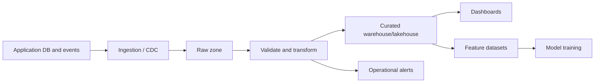

# 12A — Data engineering: events, pipelines, warehouses and governance

## 1. Why data engineering exists

An application database is optimized for operational work: account creation, order updates, post publishing and message storage. Analytics, historical reporting, machine learning and auditing have different access patterns. Running large analytical scans against the live transactional database can slow user-facing work. Data engineering builds dependable paths to move, validate, transform, store and serve data for defined purposes.

It is not merely “put everything in a data lake.” It includes contracts, quality, lineage, access, retention, deletion, privacy and cost.

## 2. A short history

Early organizations stored records in files and transaction systems. As reporting needs grew, data warehouses separated analytical queries from operational databases. Relational models and SQL gave analysts structured query tools. Later data lakes stored more varied raw data, while event streaming enabled near-real-time reactions rather than nightly batches. Cloud storage and distributed processing made large pipelines more accessible but did not remove the need for governance or quality.

Modern designs often combine operational databases, event streams, object storage, warehouses/lakehouses and specialised serving stores.

## 3. Define purpose before collecting events

For each event or dataset ask: what decision does it support? Could an aggregate or less detailed signal work? Does it contain personal, sensitive or children's data? Who may access it? How long is it retained? Can it be corrected/deleted downstream? Does it go to a vendor or another country?

Maintain a data inventory with owner, purpose, category, source, destination, access roles, retention, legal basis/consent where applicable, transfer location and deletion process.

## 4. Event design

An event records something that happened: `account_created`, `invoice_paid`, `post_published` or `video_failed`. Prefer business meaning over low-level implementation names.

Example envelope:

```json
{
  "event_id": "unique-id",
  "event_type": "post_published",
  "schema_version": 1,
  "occurred_at": "2026-11-13T12:30:00Z",
  "producer": "content-service",
  "subject_id": "pseudonymous-id",
  "request_id": "trace-id",
  "data": { "content_type": "image" }
}
```

Do not include passwords, session tokens, private messages or unnecessary personal data. Pseudonymous IDs can still be personal data if linkable to a person. Use schema contracts for important events: field names, types, required values and compatibility rules. Malformed events should be quarantined or rejected, not silently transformed into false facts.

## 5. Batch, streaming, ETL, ELT and CDC

**Batch** processes a bounded set on a schedule. It is often appropriate for daily reports, reconciliation and model training. **Streaming** continuously processes event flows; it may support live counters, alerts and fraud signals, but requires handling ordering, duplicates, late events, state and backpressure.

- **ETL:** Extract, transform, load.
- **ELT:** Extract, load raw/near-raw data, transform in the destination.
- **CDC:** Change Data Capture reads database changes. It can power downstream integration, but row changes are not always meaningful domain events.
- **Warehouse:** Governed analytical query store.
- **Data lake:** Object storage for varied raw and processed datasets.
- **Lakehouse:** Table/metadata and query layers that aim to combine lake flexibility with warehouse capabilities.

Choose the simplest processing latency that meets the use case. Streaming is not automatically better or cheaper.

## 6. Pipeline map



## 7. Data quality and observability

Monitor completeness (expected events arrived), validity (schema/rules), uniqueness (duplicates), consistency (systems agree), timeliness, freshness, distribution shifts and lineage. Reconcile financial/critical data against its source of truth. A beautiful chart from incorrect data is still incorrect.

Track pipeline failures, delayed partitions, missing source days, schema changes and unexpected row counts. Assign owners and alert thresholds based on business impact.

## 8. Governance and privacy

Use least-privilege data access, row/column controls where suitable, masking in non-production environments, encryption and audit. Restrict raw event tables because they can reveal detailed behaviour. Use aggregates when individual-level data is unnecessary.

Deletion is a pipeline problem: requests may need to propagate across operational databases, caches, search, warehouses, feature stores, models, exports, vendors and backup restoration. Design a deletion ledger/workflow. Do not claim that deleting one database row removes all copies.

## 9. Retention and lineage

Each dataset needs an owner, stated purpose, retention period and deletion/archive approach. “Keep forever just in case” is not a good default. If backups restore a deleted record, a replay process may need to reapply deletions. Lineage records which sources and transformations produced a dashboard, metric or model feature; it helps debug and assess the impact of schema changes.

## 10. Exercise

Define five events for a toy application: account created, item published, item viewed, item reported and account deleted. For each, document purpose, minimum fields, schema version, permitted consumers, retention and deletion. Write a small validator that flags malformed data.

## Sources

- Apache Kafka event streaming: https://kafka.apache.org/documentation/
- OpenLineage: https://openlineage.io/
- OpenTelemetry: https://opentelemetry.io/docs/
- Apache Iceberg: https://iceberg.apache.org/
- dbt documentation: https://docs.getdbt.com/
- NIST Privacy Framework: https://www.nist.gov/privacy-framework
