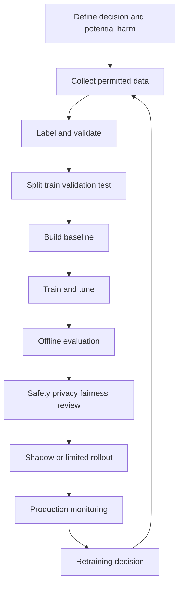

# 12C — Machine learning lifecycle, models, evaluation and MLOps

## 1. What machine learning is

Machine learning (ML) is a family of methods where a system learns patterns or parameters from data to make predictions or decisions. Traditional software usually encodes explicit rules; an ML model estimates a mapping from input features to outputs based on examples and an objective. It still needs ordinary software, data pipelines, monitoring, access controls and human decisions.

“AI” is used broadly in marketing. Classical ML includes regression, decision trees, clustering and neural networks. Deep learning uses multi-layer neural networks. Generative AI produces text, images, audio, video or structured output. These families overlap but have different data, compute and evaluation needs.

## 2. Problem types

- **Supervised learning:** Examples contain labels, e.g. spam/not spam.
- **Unsupervised learning:** Find patterns without explicit labels, e.g. clusters.
- **Self-supervised learning:** Generate learning signals from data itself; common in language/vision pretraining.
- **Reinforcement learning:** Learn actions through rewards and environment interaction; reward design and safety are difficult.
- **Ranking/recommendation:** Order candidates according to a context and objective.

First ask whether a deterministic rule, search query or ordinary statistics solves the problem. ML adds data, evaluation and maintenance complexity.

## 3. Typical lifecycle

Training data fits model parameters. Validation data supports model/hyperparameter selection. Test data estimates performance on data not used in those decisions. For time-based products, split chronologically to avoid future information leaking into the past. For user-level evaluation, prevent the same user from unintentionally appearing in train and test when that would invalidate the question.

## 4. Data leakage and feature design

Leakage occurs when training includes information that would not be available at prediction time, or target information indirectly enters a feature. It can produce excellent offline metrics and poor live behaviour. Timestamp features explicitly. Record feature definitions and the point in time when each value was known.

Avoid collecting a feature merely because it predicts well. Check necessity, privacy, lawful basis, fairness, quality, manipulation and whether users can understand/control the data use.

## 5. Evaluation depends on error costs

In a moderation classifier, recall may matter for urgent safety content, but false positives can suppress legitimate expression. A fraud model may need precision within a limited review budget. A ranking model must be checked for creator diversity and long-term effects, not just clicks.

Evaluate overall performance, calibration, false positives/negatives, subgroup/language performance where justified, robustness to missing/malformed inputs, latency, resource cost, interpretability, privacy, model security and production drift. Do not reduce quality to one number.

## 6. Overfitting, underfitting and drift

**Overfitting:** the model learns training-specific noise and generalizes poorly. **Underfitting:** the model is too limited or poorly trained. **Data drift:** input distribution changes. **Concept drift:** relationship between inputs and target changes. **Training-serving skew:** different feature logic/data appears in training and production.

Monitor input distributions, missing values, outputs, delayed labels, real quality and feedback loops. Seasonality, product changes and user mix can shift metrics without a model defect.

## 7. MLOps

MLOps applies software and data engineering to model production. Common pieces: versioned data/features, reproducible training, experiment tracking, model registry, automated evaluation gates, approval, shadow/canary rollout, monitoring, rollback, retraining policy and audit records.

A model registry should identify model version, training-data lineage, feature code, metrics, evaluation set, owner, approval and deployment history. Do not deploy simply because a training job succeeded. Keep the previous approved version available for rollback.

## 8. Deployment strategies

- **Offline evaluation:** No live decisions; test historical/labelled data.
- **Shadow mode:** Model receives live inputs but does not affect users; compare output.
- **Canary:** Serve a small eligible cohort and monitor.
- **A/B test:** Randomized comparison with pre-defined metrics and guardrails.
- **Human-in-the-loop:** Model recommends; trained people decide on cases where errors carry high harm.

Human review must not become rubber-stamping. Reviewers need evidence, time, training, escalation and appeal processes.

## 9. Recommendation example

A feed model may estimate likely relevance. The serving application must still enforce privacy, blocking and policy constraints outside the model. The model must never decide that a blocked user's post can be shown because it predicts engagement. Maintain a simple baseline and look for feedback loops that make already-popular creators impossible to displace.

## 10. Exercise

Train a small classifier on a public educational dataset. Compare it with a simple baseline, split data correctly, inspect errors and document limitations. Design deployment with versioning, rollback, monitoring and deletion handling. Do not use private customer data for a first learning exercise.

## Sources

- Google ML Crash Course: https://developers.google.com/machine-learning/crash-course
- Google Rules of ML: https://developers.google.com/machine-learning/guides/rules-of-ml
- NIST AI RMF: https://www.nist.gov/itl/ai-risk-management-framework
- NIST AI RMF Playbook: https://www.nist.gov/itl/ai-risk-management-framework/nist-ai-rmf-playbook
