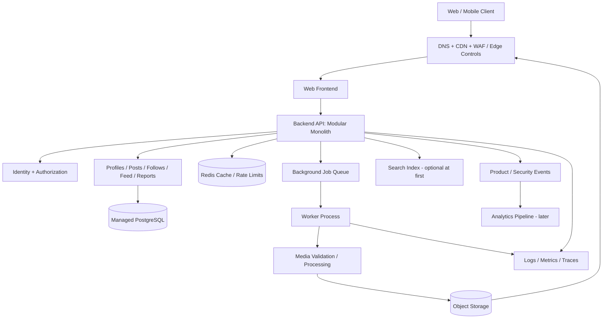

# 18A — End-to-End Reference Product and System Architecture

**Edition:** 13 November 2026  
**Prepared with:** ChatGPT (GPT-6)  
**Purpose:** Turn the handbook's concepts into one coherent, adaptable reference design. This is a teaching blueprint, not a universal architecture. The same design principles can be adapted to a social product, creator tool, marketplace, collaboration app, learning platform, SaaS product or media service.

## 1. What this capstone builds

We will use a fictional product called **CommonGround** as the running example. It helps people publish useful work, discover creators and communities, collaborate and communicate. Its first release is deliberately smaller than Instagram + YouTube + X combined.

### Initial user groups

- Members who create an account, set up a profile, discover and follow other members.
- Creators who publish text, images and short videos.
- Moderators who review reports and appeals.
- Support staff who help with account and product issues.
- Administrators who manage configuration and access—not ordinary content decisions unless their role permits it.

### Version-one capabilities

1. Signup, login, account recovery and device/session management.
2. Profile, privacy settings, block and mute.
3. Follow/unfollow.
4. Text/image posts; short video upload can be enabled after media safety and cost controls are ready.
5. Home feed with a transparent, understandable first ranking method.
6. Likes, comments, saves and reporting.
7. Search for public profiles and public content.
8. Basic notifications.
9. Admin/moderation console with strict role separation and audit logs.
10. Account export/deletion request workflow and published privacy/help pages.

### Explicit non-goals for the first release

- Global livestreaming, video calls or real-time broadcast infrastructure.
- Algorithmic ranking trained on large-scale machine-learning models.
- Advertising marketplace and creator payouts.
- End-to-end encrypted direct messaging unless the product designs and independently reviews the full protocol.
- Multiple regions active-active from day one.
- Public API ecosystem, plugins or third-party app marketplace.
- Children-directed product features before age strategy and local legal review.

A non-goal is not a promise never to build something. It prevents the first release from inheriting complexity before user demand, risk and budget justify it.

## 2. Requirements before architecture

Write measurable requirements before choosing tools.

| Category | Example requirement | How to verify |
|---|---|---|
| Functional | A user can publish a public text post | E2E test and audit event |
| Privacy | A private profile's content is not served to an unauthorised viewer | API authorization tests |
| Security | Admin routes require MFA and a separate admin role | Security test and access review |
| Reliability | Critical APIs have an agreed availability target | SLI dashboard and incident review |
| Performance | Feed first page meets an agreed p95 latency at expected load | Load test in a production-like environment |
| Accessibility | Core journeys work with keyboard and screen reader | Automated and human review |
| Data rights | Account deletion request can be tracked to completion | Workflow test and evidence record |
| Safety | Users can report content and block another account | Abuse-case tests |
| Maintainability | Changes can be tested and released without editing production manually | CI/CD evidence |

Do not invent a p95 target before measuring a baseline and defining user impact. A team may begin with a candidate target, test it, then make it an explicit service-level objective.

## 3. Recommended first architecture: modular monolith

For an early product, use one deployable backend application with clear modules, a managed relational database, object storage and a background worker. Split a module into a separate service only when its load, security boundary, release cadence or team ownership justifies the operational cost.

### Why these boundaries?

- The browser/mobile client handles interaction and presentation. It is not trusted to enforce access rules.
- The API is the policy enforcement point for account identity, authorization, validation, quotas and domain rules.
- PostgreSQL stores transactional records and relationships.
- Object storage stores media bytes; the database stores metadata and storage keys.
- Redis is an optimisation and ephemeral coordination layer. It must not be the only copy of important user data.
- Queue workers handle slow, retryable work outside the request path.
- Search is a derived index. It can lag and must not become the authority for private access decisions.
- Observability collects operational evidence but must avoid unnecessary personal data.

## 4. Request journey: a user publishes a post

1. Client sends an authenticated request over HTTPS.
2. Edge controls apply TLS policy, request-size limits, bot/rate controls and routing.
3. API validates the session/token, account status, input schema and post permissions.
4. Service applies domain rules: privacy setting, blocked relationships, posting quota, visibility and moderation state.
5. Database transaction writes the post and an outbox event together.
6. API returns a post identifier and status. It does not wait for every notification/search/analytics side effect.
7. Outbox publisher sends a durable event to the queue.
8. Workers perform allowed asynchronous tasks: notify eligible followers, update search index, process attached media and record analytics events.
9. Clients fetch the new post under current authorization rules.
10. Metrics and traces record latency/outcomes without logging secrets or private body content unnecessarily.

Use a transactional outbox or another proven reliable publication design when a database commit and event publication must not silently diverge. Consumers should be idempotent because queues commonly provide at-least-once delivery rather than magical exactly-once side effects.

## 5. The first feed should be understandable

Start with a simple candidate set: recent eligible posts from followed accounts, plus a small explicitly labelled discovery area. Apply privacy, block, mute, deleted-content and moderation filters before display. Sort by recency or a small documented score. Log only the signals necessary to evaluate usefulness and safety.

Do not copy engagement-maximising ranking blindly. Define product goals such as relevance, creator diversity, user control, freshness, low abuse exposure and user satisfaction. Provide controls such as mute, block, hide, not-interested and chronological options where appropriate.

## 6. Global-by-design, not global-by-default

A product can be accessible worldwide without immediately operating active-active databases in every region. A first launch can use one selected hosting region and a CDN, but must still map:

- User locations and intended markets.
- Where account data, media, backups, logs and support tickets are stored.
- Which vendors/subprocessors receive data.
- Which staff locations can remotely access it.
- Whether cross-border transfer mechanisms or local residency requirements apply.
- How regional content restrictions and legal orders are reviewed.

Select locations only after data mapping, latency testing, vendor contract review and legal analysis. Do not assume a cloud-region name alone proves compliance.

## 7. Alternatives and when to change architecture

| Choice | Start with | Reconsider when |
|---|---|---|
| Monolith vs microservices | Modular monolith | Independent scale/release/team/security boundaries justify service split |
| SQL vs document DB | PostgreSQL for relational core | A workload has a demonstrated document/search/time-series need |
| Managed queue vs self-hosted broker | Managed queue/job service | Throughput, features, portability or cost justify operating a broker |
| CDN vs direct object access | CDN with controlled cache policy | Private access, invalidation or cost requirements require a different design |
| One region vs multi-region | One primary region + tested backup plan | Regulatory, latency or recovery needs justify added complexity |
| Build vs buy | Managed commodity services | Strategic differentiation, control or economics justify ownership |

## 8. Architecture decision records

For every major decision, save an ADR containing: title, date, status, context, decision, alternatives, consequences, owner and revisit trigger. Example: “Use PostgreSQL as the system of record for accounts and posts; revisit only if measured workload or data model demands another store.” This prevents technology choices from becoming unexplained folklore.

## 9. Acceptance checks for this chapter

- Can you explain each component and why it exists?
- Can you trace a request from browser to database and back?
- Can you identify the trust boundary between client, API, worker, storage and admin tools?
- Can you explain which data is authoritative and which is derived/cacheable?
- Can you name the non-goals that protect the MVP from scope explosion?
- Can you state which assumptions need load tests, security review or legal review?

## References

- IETF RFC Editor: https://www.rfc-editor.org/ (network protocol standards)
- OWASP: https://owasp.org/ (application security guidance)
- CNCF Cloud Native Glossary: https://glossary.cncf.io/ (cloud-native concepts)
- OpenTelemetry: https://opentelemetry.io/docs/ (telemetry standards and concepts)
- PostgreSQL documentation: https://www.postgresql.org/docs/
- NIST Cybersecurity Framework: https://www.nist.gov/cyberframework
