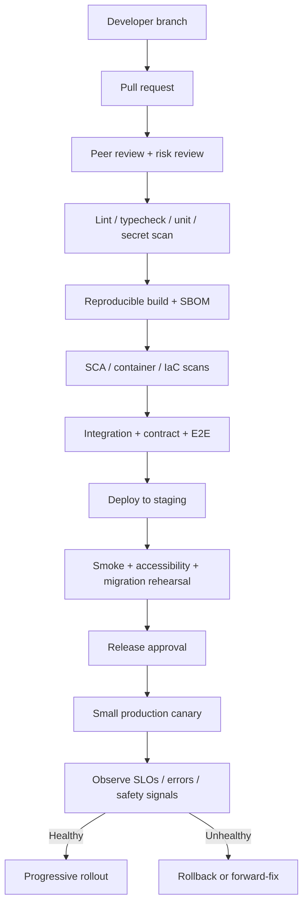

# 18D — Testing, Deployment, Operations, Runbooks and Recovery

**Edition:** 13 November 2026  
**Prepared with:** ChatGPT (GPT-6)  
**Purpose:** Define how a team moves code from a developer machine to a safely operated production service, proves that critical journeys work, responds to incidents and restores service/data.

## 1. Environment model

Use separate environments with separate identities, credentials, data and access controls:

- **Local:** developer machine; synthetic/sample data; local dependencies.
- **CI:** ephemeral test environment; no production secrets/data.
- **Development/integration:** shared team testing.
- **Staging:** production-like configuration with synthetic or properly anonymised data.
- **Production:** restricted access, approved release process, monitored and backed up.

Production data should not be casually copied to laptops or staging. If support or debugging needs a real record, use a documented, authorised, minimised and audited workflow.

## 2. Test strategy by risk

| Test type | Example in this product | Evidence |
|---|---|---|
| Unit | Visibility policy rejects private post for unrelated viewer | Test result |
| Integration | Post transaction writes database and outbox event atomically | Integration test |
| Contract | Mobile client and API agree on response schema | Contract test |
| E2E | Signup → verify → publish → report → block | Browser/mobile journey |
| Security | User A cannot access User B's private post by changing an ID | Authorisation test |
| Performance | Feed and upload-intent endpoints under expected concurrency | Load-test report |
| Resilience | Queue unavailable; API degrades without losing committed post | Failure-injection exercise |
| Recovery | Restore backup to isolated environment and verify data | Restore report |
| Accessibility | Keyboard and screen-reader completion of core tasks | Accessibility audit |
| Compatibility | Supported browsers and previous mobile app version | Device/browser matrix |
| Privacy | Deletion request propagates to defined systems | Workflow evidence |

Test negative cases, not only the happy path. Include stale sessions, duplicate clicks, network interruption, slow devices, malformed input, large payloads, account suspension, block relationships, private content, moderator permissions and vendor outage.

## 3. Test data and privacy

Prefer generated synthetic accounts/content. Anonymisation can be reversible or incomplete; do not assume replacing names makes a dataset anonymous. Restrict, document and expire any production-derived test data. Never place real passwords, API tokens, payment data or private conversations in a public bug report.

## 4. CI/CD release pipeline

A pipeline should fail closed for required checks. Make exceptions visible, time-limited and approved. Keep build provenance and artefacts identifiable. Pin dependencies and review updates. A successful CI build is evidence of tests passing, not proof of security or absence of defects.

## 5. Database release safety

Use expand-and-contract migrations:

1. Add a backward-compatible column/table/index.
2. Deploy code that can read old and new forms safely.
3. Backfill gradually with monitoring and throttling.
4. Switch writes/reads behind a controlled release.
5. Confirm old code no longer uses the old field.
6. Remove obsolete schema in a later release.

Before migration, test runtime, lock behaviour, disk requirements, replication effects and recovery path against a representative dataset. Do not assume application rollback automatically rolls back data safely. Some migrations require a forward fix.

## 6. Release checklist

- Product requirement and acceptance criteria approved.
- API/data compatibility checked with supported clients.
- Automated tests and manual exploratory tests completed.
- Security/privacy/safety impact reviewed.
- Feature flag and kill switch available for risky features.
- Database migration rehearsed and owner assigned.
- Backups healthy and restore evidence recent.
- Monitoring, dashboard and alert thresholds ready.
- Rollback/forward-fix path documented.
- Support/moderation teams briefed where workflows change.
- Changelog and user communication prepared.
- On-call owner available for the rollout window.

## 7. Service-level indicators and objectives

Choose SLIs that represent user experience:

- Availability of critical user journeys, not only process uptime.
- Latency percentiles for feed, login, upload initiation and media playback.
- Error rate by endpoint and client version.
- Upload completion and processing success.
- Queue age/backlog.
- Data freshness for search/feed indexes.
- Account recovery success and support time.
- Safety-report acknowledgement and resolution performance, under applicable rules.

An SLO is a target over a defined window. An error budget is the allowed unreliability under that target. Do not treat a generic “99.9%” as meaningful until service scope, measurement, dependencies and exclusions are defined.

## 8. Operational runbooks

### Runbook A — API error spike

1. Confirm alert and user impact; identify affected routes/regions/versions.
2. Check recent deploys, dependency health, database pool, queue pressure and edge errors.
3. Mitigate safely: disable risky feature flag, reduce optional workload, shift traffic or rollback if evidence points to release regression.
4. Avoid repeated restarts that destroy evidence or worsen recovery.
5. Verify core flows and SLO recovery.
6. Communicate status and open follow-up actions.

### Runbook B — Suspected account takeover

1. Open security incident; restrict access to the affected account and preserve relevant audit evidence.
2. Revoke sessions/tokens and reset recovery factors through a verified process.
3. Check admin actions, connected apps, email/phone changes and suspicious activity.
4. Prevent attacker re-entry; support the genuine user safely.
5. Assess data exposure and notification duties with privacy/legal owner.
6. Review root cause and improve detection/recovery.

### Runbook C — Media upload or processing outage

1. Separate client upload failure, object-store failure and worker/transcoding failure.
2. Check signed URL expiry, storage quota, queue age, worker CPU/memory and media parser errors.
3. Stop accepting formats/sizes that cannot be safely processed; retain clear user status.
4. Retry only idempotent jobs; quarantine poisoned inputs.
5. Reconcile orphaned objects and stale `processing` records.
6. Confirm playback/cache access for public and private media.

### Runbook D — Database failure or data corruption

1. Declare incident and appoint incident commander/database owner.
2. Stop risky writes or isolate affected feature if needed.
3. Preserve logs, snapshots and transaction evidence.
4. Determine recovery point/time and business impact.
5. Restore to an isolated environment first; validate schema, counts, constraints and application behaviour.
6. Promote restored service only after approval; reconcile events created after the recovery point.
7. Reapply deletion/legal holds if a backup restore reintroduces records that had been deleted.
8. Communicate impact and complete a postmortem.

### Runbook E — Privacy or personal-data incident

1. Activate security and privacy incident owners immediately.
2. Establish what data, people, systems, vendors and countries may be affected.
3. Contain ongoing access/exfiltration without destroying evidence.
4. Record timeline and facts; distinguish confirmed from suspected exposure.
5. Legal/privacy lead assesses regulator/user/vendor notification thresholds and deadlines per jurisdiction.
6. Mitigate, support affected people where appropriate, document decisions and preserve evidence.
7. Complete root-cause actions and verify controls.

## 9. Backup and disaster recovery

- Back up database and object metadata; define media-object backup/versioning separately.
- Encrypt backups, restrict access and maintain copies isolated from normal production credentials.
- Define retention, legal hold and deletion interactions.
- Monitor backup completion and restoreability.
- Test restore regularly into an isolated environment.
- Measure RPO (acceptable data-loss window) and RTO (acceptable restore time) based on business impact.
- Test region/vendor outage assumptions; a replica alone is not a backup.
- Document the recovery sequence and who can authorise promotion.

## 10. Support and customer communication

Classify requests: account access, privacy rights, safety report, copyright, payment, bug, feedback and security incident. Each queue needs owner, severity, SLA target, escalation path, evidence policy and closure criteria. Never ask a user to send passwords or MFA codes. Staff tools should show only fields needed for the case.

## 11. Postmortem format

- Summary and user impact.
- Timeline with timezone.
- Detection and response.
- Technical and organisational contributing factors.
- What worked and what failed.
- Data/safety/legal consequences.
- Corrective actions with owner, due date and validation test.
- Lessons shared without blame.

## References

- Google SRE books: https://sre.google/books/
- OpenTelemetry: https://opentelemetry.io/docs/
- NIST SP 800-61 incident response resources: https://csrc.nist.gov/pubs/sp/800/61/r2/final
- GitHub Actions documentation: https://docs.github.com/actions
- OWASP SAMM: https://owaspsamm.org/
